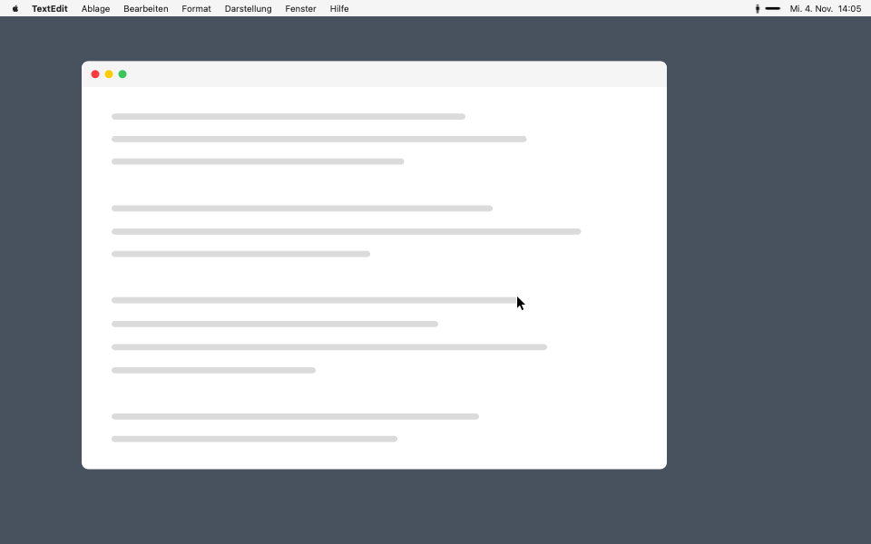

<p align="center"><a href="README.md">English</a> · <strong>Deutsch</strong></p>

<p align="center">
  
</p>

<h1 align="center">Stehauf</h1>

<p align="center">
  <strong>Die Mac-App, die dich vom Stuhl holt.</strong><br>
  Nach 55 Minuten am Bildschirm füllt ein großes „Steh auf.“ den ganzen Monitor, damit du dir fünf Minuten Bewegung gönnst.
</p>

<p align="center">
  
  
  
  <a href="LICENSE"></a>
</p>

<p align="center">
  <a href="https://github.com/legolas-stz/stehauf/releases/latest/download/Stehauf.zip"><strong>⬇︎ Stehauf herunterladen</strong></a>
  &nbsp;·&nbsp;
  <a href="#so-funktioniert-es">So funktioniert es</a>
  &nbsp;·&nbsp;
  <a href="#einstellungen">Einstellungen</a>
  &nbsp;·&nbsp;
  <a href="#warum-55-minuten-und-5-minuten-pause">Warum 55 Minuten?</a>
</p>

## Warum Stehauf

- **Nicht zu übersehen:** Der Hinweis füllt alle Monitore, statt als Mitteilung unterzugehen.
- **Stört keine Meetings:** Solange Mikrofon oder Kamera laufen, wartet die Erinnerung.
- **Zählt nur echte Zeit am Mac:** 5 Minuten Sperren, Ruhezustand oder schlafendes Display setzen die Zeit zurück.
- **Privat:** Kostenlos, ohne Konto, ohne Berechtigungen. Stehauf fragt nur einmal am Tag bei GitHub nach einer neuen Version.

## Installieren

**[⬇︎ Stehauf herunterladen](https://github.com/legolas-stz/stehauf/releases/latest/download/Stehauf.zip)**

1. Öffne die heruntergeladene Datei und dann die App **Stehauf**.
2. Klicke auf **Installieren**.

Das war's. Stehauf liegt jetzt im Programme-Ordner, sitzt oben rechts in der Menüleiste und startet ab jetzt von selbst, wenn du dich anmeldest. Die heruntergeladene Datei kannst du löschen.

**Oder im Terminal**, ganz ohne Rückfrage von macOS:

```sh
curl -fsSL https://raw.githubusercontent.com/legolas-stz/stehauf/main/get.sh | sh
```

Du brauchst macOS 14.4 oder neuer. Stehauf läuft auf allen Macs mit Apple-Chip oder Intel-Prozessor und spricht Deutsch oder Englisch, je nach Sprache deines Macs.

### Wenn macOS das Öffnen verweigert

Beim ersten Öffnen meldet macOS vermutlich, es könne Stehauf nicht auf Schadsoftware überprüfen. Das liegt daran, dass Stehauf nicht bei Apple registriert ist. So öffnest du es trotzdem:

1. Klicke im Hinweis auf **Fertig**, nicht auf „In den Papierkorb legen“.
2. Öffne **Systemeinstellungen → Datenschutz & Sicherheit** und scrolle nach unten.
3. Klicke bei Stehauf auf **Dennoch öffnen** und bestätige mit Passwort oder Touch ID.

Das ist nur einmal nötig. Der [Quellcode](main.swift) ist öffentlich, falls du nachsehen möchtest, was Stehauf tut. Mit dem Terminal-Befehl oben erscheint die Warnung gar nicht erst.

## So funktioniert es

- **Die Erinnerung:** Klicke auf **Erledigt** oder drücke Esc, dann beginnen die 55 Minuten von vorn. Mit Enter geht der Hinweis absichtlich nicht weg, damit er beim Tippen nicht aus Versehen verschwindet. Er erscheint auch, wenn ein Fokus wie „Nicht stören“ an ist.
- **In Meetings:** Solange Mikrofon oder Kamera laufen, wartet die Erinnerung bis nach dem Meeting. Stehauf schaut dafür nur nach, ob die Geräte aktiv sind. Es hört und sieht nichts mit und fragt deshalb auch nicht nach einer Berechtigung.
- **In Pausen:** Ist der Mac 5 Minuten gesperrt oder schläft er oder sein Display so lange, beginnt die Zeit von vorn.

Bleibt die Erinnerung aus, zeigt ein Klick auf die Figur in der Menüleiste den Grund. Jede App, die das Mikrofon offen hält, zählt als Meeting, auch ein vergessener Browser-Tab.

## Einstellungen

Ein Klick auf die kleine Figur oben rechts in der Menüleiste zeigt die verbleibende Zeit, ein Rechtsklick die Einstellungen. Der Balken daneben zählt bis zur nächsten Erinnerung herunter. Wartet Stehauf auf das Ende eines Meetings, siehst du statt der Figur ein Mikrofon oder eine Kamera.

| Eintrag | Standard | Bedeutung |
| --- | --- | --- |
| Auch in Meetings erinnern | aus | Erinnert auch, solange Mikrofon oder Kamera laufen, dann ohne Ton |
| Beim Anmelden starten | an | Startet Stehauf automatisch |
| Erinnern nach | 55 Min | Zeit am Mac bis zur Erinnerung |
| Darstellung | System | Hinweis hell, dunkel oder passend zum System |

## Aktualisieren und entfernen

**Aktualisieren:** Lade Stehauf wie oben neu herunter, öffne es und klicke auf **Installieren**, oder führe den Terminal-Befehl noch einmal aus. Deine Einstellungen bleiben erhalten. Gibt es eine neue Version, erscheint im Menü von Stehauf **Update laden**. Alle Versionen findest du unter [Releases](https://github.com/legolas-stz/stehauf/releases).

**Entfernen:** Klicke mit rechts auf die Figur, wähle **Stehauf beenden** und ziehe Stehauf aus dem Programme-Ordner in den Papierkorb. Steht es danach noch unter **Systemeinstellungen → Allgemein → Anmeldeobjekte**, kannst du den Eintrag dort löschen.

## Warum 55 Minuten und 5 Minuten Pause?

Eine amtlich festgelegte Minutenzahl fürs Sitzen gibt es in Deutschland nicht. Der Standard von 55 + 5 Minuten ist der Wert, auf den die konkreten Angaben am ehesten zulaufen. Eine medizinische Empfehlung ist das nicht.

Wer mehr will, stellt 30 Minuten ein. Das wirkt in den Studien am stärksten, ist im Alltag aber schwerer durchzuhalten.

<details>
<summary><strong>Quellen ansehen</strong></summary>

<br>

| Quelle | Aussage | Art |
| --- | --- | --- |
| [ASR A6, Nr. 5.3](https://vorschriften.bgn-branchenwissen.de/daten/tr/asr_a6/5.htm) (Deutschland, 2024) | Etwa 5 Minuten Erholung pro Stunde ununterbrochener Bildschirmarbeit haben sich bewährt, Bewegungsübungen sind günstig, mehrere kurze Pausen sind besser als wenige lange | Technische Regel für Arbeitgeber |
| [Nationale Bewegungsempfehlungen](https://www.bundesgesundheitsministerium.de/fileadmin/Dateien/3_Downloads/B/Bewegung/Nationale-Empfehlungen-fuer-Bewegung-und-Bewegungsfoerderung-2016.pdf) (Deutschland, 2016) | Lange Sitzphasen meiden und regelmäßig mit Bewegung unterbrechen, ohne Minutenwert | Empfehlung, vom Bundesgesundheitsministerium veröffentlicht |
| [gesund.bund.de](https://gesund.bund.de/en/gesund-durch-bewegung) (Deutschland) | Mehrere kurze Bewegungspausen, etwa Gehen, Dehnen oder Treppensteigen, ohne Minutenwert | Gesundheitsportal des Bundes |
| [WHO-Leitlinie](https://pmc.ncbi.nlm.nih.gov/articles/PMC7691115) (2020) | Weniger sitzen, aber die Daten reichen nicht für Vorgaben zu Häufigkeit oder Dauer von Pausen | Internationale Leitlinie |
| [§ 10 BS-V](https://www.ris.bka.gv.at/eli/bgbl/ii/1998/124/P10/NOR12115561) (Österreich) | Nach 50 Minuten Bildschirmarbeit mindestens 10 Minuten Pause oder Tätigkeitswechsel | Gesetz |
| [BJSM-Studie](https://bmjgroup.com/hourly-movement-breaks-feasible-and-effective-for-mitigating-sedentary-harms/) (2026, rund 19.000 Teilnehmende) | 5 Minuten Gehen stündlich bieten die beste Balance aus Wirkung und Umsetzbarkeit, alle 30 Minuten wirkt am stärksten, alle 120 am schwächsten | Alltagsstudie mit Selbstangaben |
| [Duran et al.](https://bibliography.cumc.columbia.edu/node/40615) (2023, 11 Teilnehmende) | Nur 5 Minuten Gehen alle 30 Minuten senken den Blutzuckeranstieg deutlich, den Blutdruck senken auch kürzere und seltenere Pausen | Kleine randomisierte Crossover-Studie |

Für die Augen lohnt sich in der Pause ein Blick in die Ferne. Das empfiehlt auch die [20-20-20-Regel](https://www.aao.org/eye-health/diseases/what-is-eye-strain) der American Academy of Ophthalmology: alle 20 Minuten für 20 Sekunden etwa 6 Meter weit schauen. Die Belege dafür sind gemischt. [Eine kleine Studie](https://research.aston.ac.uk/en/publications/the-effects-of-breaks-on-digital-eye-strain-dry-eye-and-binocular/) fand weniger Beschwerden, solange die Erinnerungen liefen, [eine andere](https://www.reviewofoptometry.com/news/article/202020-still-not-enough-to-alleviate-eye-strain) keinen Nutzen von 20-Sekunden-Pausen. Deshalb unterbricht Stehauf dich dafür nicht alle 20 Minuten.

</details>

## Für Entwickler

Du brauchst die Xcode Command Line Tools (`xcode-select --install`).

```sh
git clone https://github.com/legolas-stz/stehauf.git
cd stehauf
./install.sh
```

| Skript | Zweck |
| --- | --- |
| `./build.sh` | Baut `build/Stehauf.app` für Apple Silicon und Intel |
| `./install.sh` | Baut und installiert nach `/Applications` |
| `./test.sh` | Baut und zeigt den Hinweis sofort, mit `./test.sh en` auf Englisch |
| `./uninstall.sh` | Entfernt die App und ihre Einstellungen |

GitHub Actions baut jeden Push auf `main` und jeden Pull Request.

`get.sh` ist der Terminal-Installer aus dem README. Er lädt das neueste Release, beendet eine laufende Version und ersetzt sie.

## Lizenz

[MIT](LICENSE)
