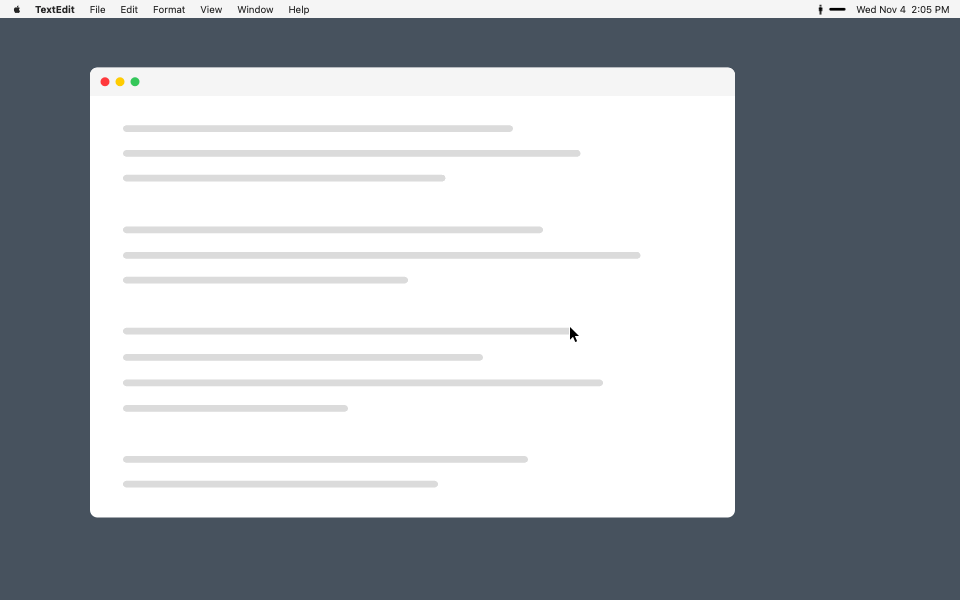

<p align="center"><strong>English</strong> · <a href="README.de.md">Deutsch</a></p>

<p align="center">
  
</p>

<h1 align="center">Stehauf</h1>

<p align="center">
  <strong>The Mac app that gets you out of your chair.</strong><br>
  After 55 minutes at your screen, a big “Stand up.” fills the whole display, so you treat yourself to five minutes of movement.
</p>

<p align="center">
  
  
  
  <a href="LICENSE"></a>
</p>

<p align="center">
  <a href="https://github.com/legolas-stz/stehauf/releases/latest/download/Stehauf.zip"><strong>⬇︎ Download Stehauf</strong></a>
  &nbsp;·&nbsp;
  <a href="#how-it-works">How it works</a>
  &nbsp;·&nbsp;
  <a href="#settings">Settings</a>
  &nbsp;·&nbsp;
  <a href="#why-55-minutes-and-a-5-minute-break">Why 55 minutes?</a>
</p>

## Why Stehauf

- **Impossible to miss:** The reminder fills every display instead of getting lost as a notification.
- **Doesn't interrupt meetings:** While your microphone or camera is on, the reminder waits.
- **Only counts real time at your Mac:** 5 minutes of locking, sleep or a sleeping display reset the timer.
- **Private:** Free, no account, no permissions. The only thing Stehauf sends is a daily check with GitHub for a new version.

*Stehauf* is German for “stand up”.

## Install

**[⬇︎ Download Stehauf](https://github.com/legolas-stz/stehauf/releases/latest/download/Stehauf.zip)**

1. Open the downloaded file, then open the **Stehauf** app.
2. Click **Install**.

That's it. Stehauf now lives in your Applications folder, sits at the top right of the menu bar, and opens on its own whenever you log in. You can delete the downloaded file.

**Or in the Terminal**, without any prompt from macOS:

```sh
curl -fsSL https://raw.githubusercontent.com/legolas-stz/stehauf/main/get.sh | sh
```

You need macOS 14.4 or later. Stehauf runs on every Mac with Apple silicon or an Intel processor and speaks English or German, depending on your Mac's language.

### If macOS refuses to open it

The first time you open Stehauf, macOS will probably say it can't check it for malware. That's because Stehauf isn't registered with Apple. Here's how to open it anyway:

1. Click **Done** in the message, not “Move to Trash”.
2. Open **System Settings → Privacy & Security** and scroll down.
3. Next to Stehauf, click **Open Anyway** and confirm with your password or Touch ID.

You only need to do this once. The [source code](main.swift) is public if you want to see what Stehauf does. With the Terminal command above, the warning doesn't appear at all.

## How it works

- **The reminder:** Click **Done** or press Esc and the 55 minutes start over. Return deliberately doesn't dismiss it, so it can't vanish by accident while you're typing. It also shows up when a Focus like “Do Not Disturb” is on.
- **In meetings:** While your microphone or camera is on, the reminder waits until the meeting is over. Stehauf only checks whether the devices are active. It doesn't listen or watch, which is why it never asks for permission.
- **During breaks:** If your Mac stays locked, or it or its display sleeps, for 5 minutes, the timer starts over.

If the reminder doesn't appear, clicking the figure in the menu bar shows why. Any app that keeps the microphone open counts as a meeting, including a forgotten browser tab.

## Settings

Click the small figure at the top right of the menu bar to see the time left; right-click it for the settings. The bar next to it counts down to the next reminder. While Stehauf is waiting for a meeting to end, you'll see a microphone or camera instead of the figure.

| Item | Default | What it does |
| --- | --- | --- |
| Remind during meetings | off | Also reminds you while the microphone or camera is on, without sound |
| Open at login | on | Starts Stehauf automatically |
| Remind after | 55 min | Time at your Mac until the reminder |
| Appearance | System | Reminder in light, dark or matching the system |

## Update and remove

**Update:** Download Stehauf again as above, open it and click **Install**, or run the Terminal command again. Your settings are kept. When a new version is out, **Download Update** appears in Stehauf's menu. All versions are listed under [Releases](https://github.com/legolas-stz/stehauf/releases).

**Remove:** Right-click the figure, choose **Quit Stehauf**, and drag Stehauf from the Applications folder to the Trash. If it's still listed under **System Settings → General → Login Items** afterwards, you can delete the entry there.

## Why 55 minutes and a 5-minute break?

There's no official number of minutes you should sit at most. The default of 55 + 5 minutes is the value the concrete guidance comes closest to, mostly from German workplace rules. It isn't medical advice.

If you want more, set it to 30 minutes. That has the strongest effect in studies, but is harder to stick to in everyday life.

<details>
<summary><strong>Show sources</strong></summary>

<br>

| Source | Statement | Type |
| --- | --- | --- |
| [ASR A6, No. 5.3](https://vorschriften.bgn-branchenwissen.de/daten/tr/asr_a6/5.htm) (Germany, 2024, in German) | About 5 minutes of recovery per hour of uninterrupted screen work has proven effective; exercise is beneficial; several short breaks are better than a few long ones | Technical rule for employers |
| [National physical activity recommendations](https://www.bundesgesundheitsministerium.de/fileadmin/Dateien/3_Downloads/B/Bewegung/Nationale-Empfehlungen-fuer-Bewegung-und-Bewegungsfoerderung-2016.pdf) (Germany, 2016, in German) | Avoid long periods of sitting and break them up regularly with movement, no number of minutes | Recommendation published by the Federal Ministry of Health |
| [gesund.bund.de](https://gesund.bund.de/en/gesund-durch-bewegung) (Germany) | Several short movement breaks, such as walking, stretching or taking the stairs, no number of minutes | German federal health portal |
| [WHO guidelines](https://pmc.ncbi.nlm.nih.gov/articles/PMC7691115) (2020) | Sit less, but the data isn't sufficient to recommend how often or how long to break | International guideline |
| [§ 10 BS-V](https://www.ris.bka.gv.at/eli/bgbl/ii/1998/124/P10/NOR12115561) (Austria, in German) | After 50 minutes of screen work, at least a 10-minute break or a change of activity | Law |
| [BJSM study](https://bmjgroup.com/hourly-movement-breaks-feasible-and-effective-for-mitigating-sedentary-harms/) (2026, about 19,000 participants) | 5 minutes of walking every hour offers the best balance of effect and feasibility; every 30 minutes works best, every 120 worst | Everyday study with self-reported data |
| [Duran et al.](https://bibliography.cumc.columbia.edu/node/40615) (2023, 11 participants) | Just 5 minutes of walking every 30 minutes markedly lowers blood sugar spikes; shorter and less frequent breaks also lower blood pressure | Small randomized crossover study |

For your eyes, it's worth looking into the distance during the break. That's also what the [20-20-20 rule](https://www.aao.org/eye-health/diseases/what-is-eye-strain) from the American Academy of Ophthalmology suggests: every 20 minutes, look about 20 feet (6 meters) away for 20 seconds. The evidence is mixed. [One small study](https://research.aston.ac.uk/en/publications/the-effects-of-breaks-on-digital-eye-strain-dry-eye-and-binocular/) found fewer symptoms while the reminders were running, [another](https://www.reviewofoptometry.com/news/article/202020-still-not-enough-to-alleviate-eye-strain) found no benefit from 20-second breaks. That's why Stehauf doesn't interrupt you every 20 minutes for it.

</details>

## For developers

You need the Xcode Command Line Tools (`xcode-select --install`).

```sh
git clone https://github.com/legolas-stz/stehauf.git
cd stehauf
./install.sh
```

| Script | Purpose |
| --- | --- |
| `./build.sh` | Builds `build/Stehauf.app` for Apple silicon and Intel |
| `./install.sh` | Builds and installs to `/Applications` |
| `./test.sh` | Builds and shows the reminder right away, in German with `./test.sh de` |
| `./uninstall.sh` | Removes the app and its settings |

Every push to `main` and every pull request is built on GitHub Actions.

`get.sh` is the Terminal installer from this README. It downloads the latest release, quits a running copy and replaces it.

The app's texts live directly in [main.swift](main.swift) as `tr("Deutsch", "English")` pairs.

## License

[MIT](LICENSE)
